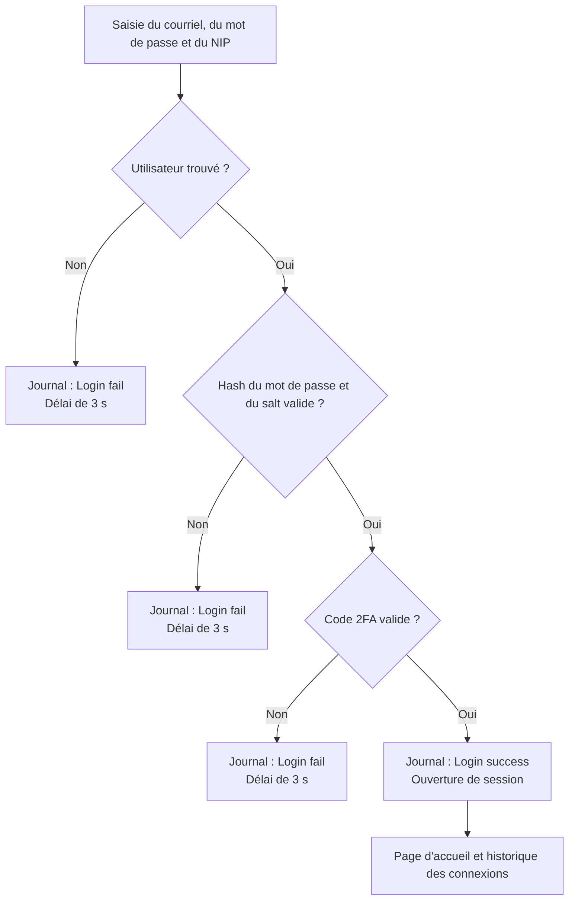
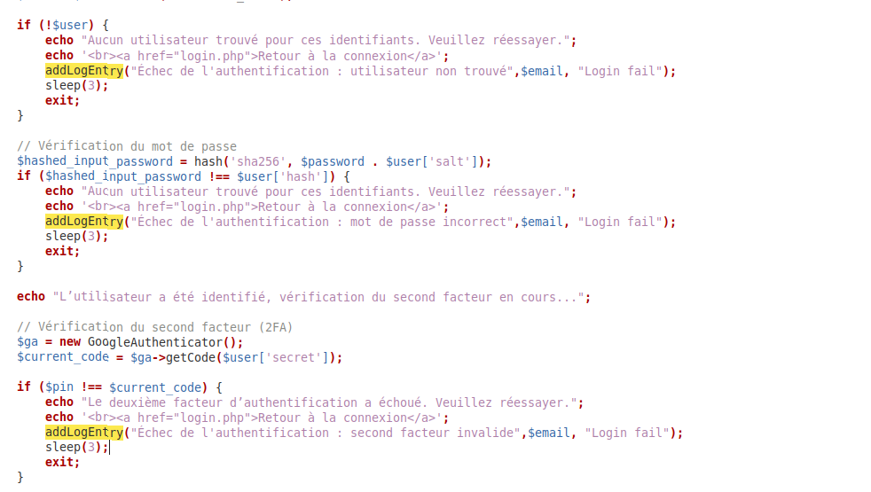
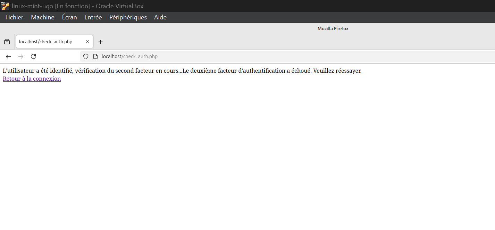
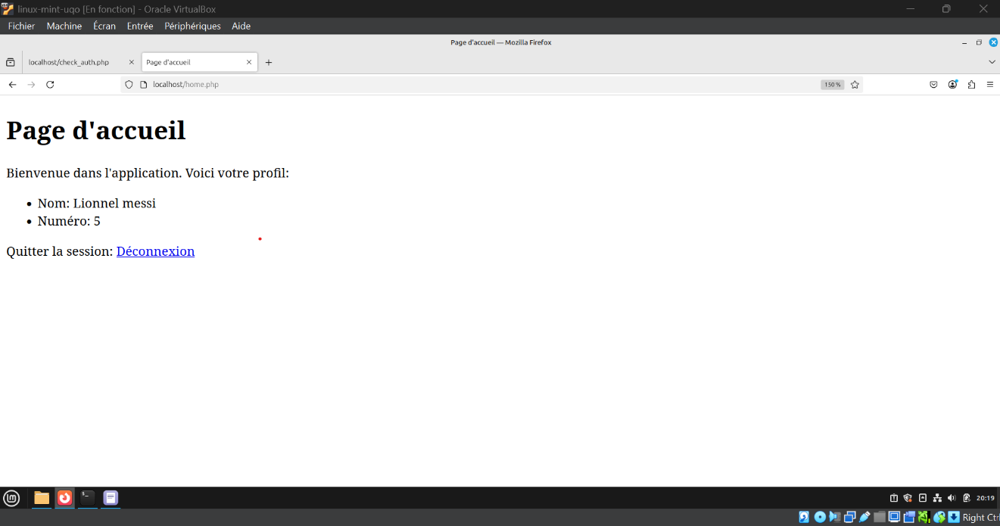
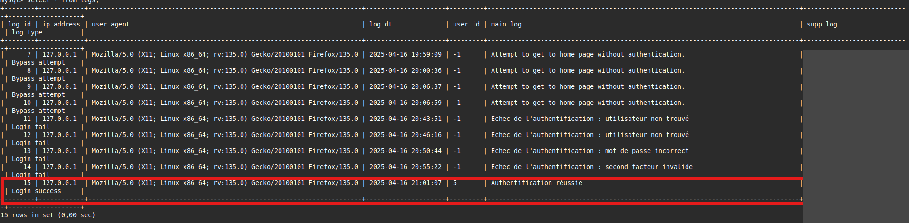
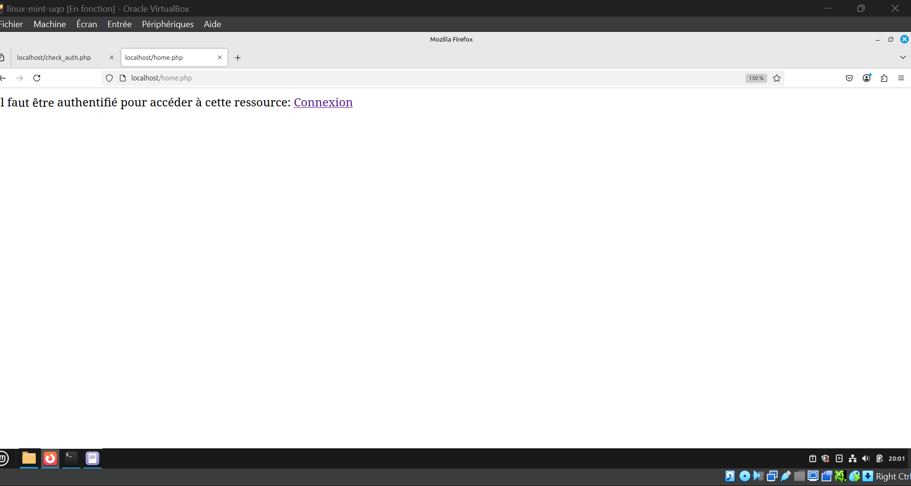
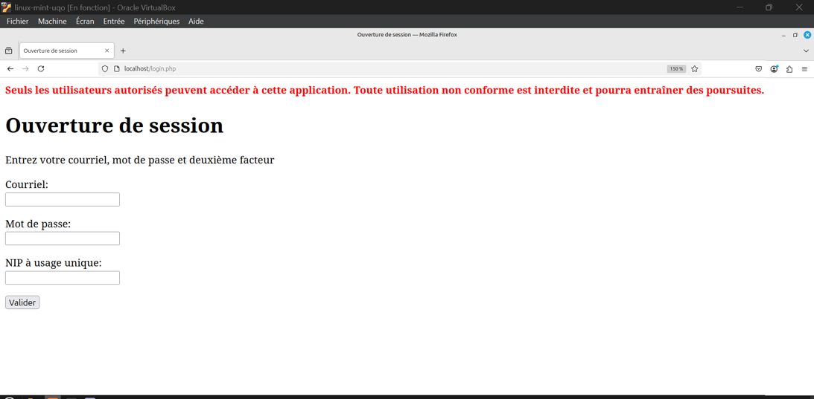
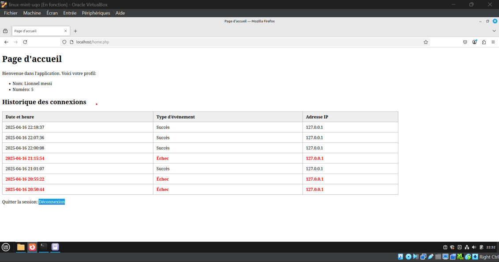
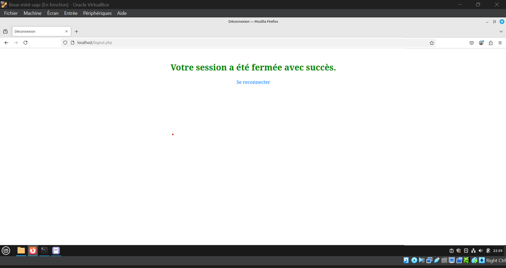

# Authentification à deux facteurs et contrôle d'accès sur une application LAMP

Projet universitaire sur la sécurité des données et le contrôle d'accès organisationnel, réalisé à l'Université du Québec en Outaouais (2025).

Sécurisation d'une application web PHP/MySQL hébergée sur Apache : connexion par mot de passe et code à usage unique, journalisation des événements d'authentification, contrôles d'accès techniques et analyse de quatre scénarios d'attaque.

> **English summary:** Team university project securing a LAMP web application with two-factor authentication (Google Authenticator), salted password hashing, authentication logging, technical access controls (AC-7, AC-8, AC-9, AC-12) and an analysis of four common attacks.

**Équipe :** Alpha Boubacar Diallo, Ibrahima Sory Diaby, Farid Adéyèmi Kegnide

## Technologies

| Domaine | Outils |
|---|---|
| Environnement | Linux Mint, VirtualBox |
| Application | Apache2, PHP, MySQL |
| Authentification | SHA-256 avec salt, codes à usage unique, Google Authenticator |

## Parcours d'authentification

## Réalisations

### 1. Authentification à deux facteurs

Le script `check_auth.php` vérifie les informations en trois étapes :

1. Il recherche l'utilisateur à partir du courriel.
2. Il concatène le mot de passe et le salt du compte, applique SHA-256, puis compare le résultat au hash enregistré.
3. Il génère le code attendu à partir de la clé secrète du compte et le compare au NIP saisi.

### 2. Journalisation

Chaque résultat est enregistré dans la table `logs`, avec l'adresse IP, le navigateur, la date et le courriel concerné.

| Situation | Message | Catégorie |
|---|---|---|
| Utilisateur introuvable | Échec de l'authentification : utilisateur non trouvé | `Login fail` |
| Mot de passe incorrect | Échec de l'authentification : mot de passe incorrect | `Login fail` |
| Code 2FA invalide | Échec de l'authentification : second facteur invalide | `Login fail` |
| Connexion réussie | Authentification réussie | `Login success` |

La page d'accueil est aussi refusée sans authentification, et ces tentatives apparaissent dans le journal comme `Bypass attempt`.

### 3. Contrôles d'accès techniques

| Contrôle | Mise en œuvre |
|---|---|
| **AC-7** : tentatives échouées | Délai de 3 secondes après chaque échec avec `sleep(3)` |
| **AC-8** : avis d'utilisation | Avertissement affiché sur la page de connexion |
| **AC-9** : connexions précédentes | Historique personnel affiché à l'utilisateur, avec les échecs en rouge |
| **AC-12** : fermeture de session | Déconnexion manuelle avec message de confirmation |

### 4. Analyse de sécurité

Attaques classées de la plus grave à la moins critique selon notre analyse :

| Rang | Attaque | Contrôle en place | Améliorations proposées |
|---|---|---|---|
| 1 | Ingénierie sociale | 2FA | Sensibilisation au hameçonnage, vérification des communications officielles |
| 2 | Bourrage de justificatifs | 2FA | Détection d'activité inhabituelle, blocage temporaire, CAPTCHA |
| 3 | Interception de paquets | Voir les limites ci-dessous | VPN sur les réseaux publics, HTTPS avec HSTS |
| 4 | Espionnage visuel | Code renouvelé toutes les 30 secondes | Saisie masquée, rappels de vigilance |

## Limites et améliorations possibles

- **Hachage :** SHA-256 est rapide, donc moins adapté aux mots de passe que `password_hash()` avec bcrypt ou Argon2.
- **Tentatives répétées :** le délai de 3 secondes ralentit les attaques, mais ne bloque pas le compte après plusieurs échecs.
- **Messages d'erreur :** le message « L'utilisateur a été identifié » indique qu'un mot de passe est correct avant la vérification du second facteur.
- **HTTPS :** les captures montrent des tests sur `localhost`, sans preuve de chiffrement. Le chiffrement du trafic reste à valider dans un vrai déploiement.

## Note sur ce dépôt

Ce dépôt présente le projet à partir de son rapport, et le code source complet n'y figure pas. Le code QR, la table des utilisateurs (hash, salt et clés secrètes) et les autres captures sensibles ont été exclus, et les courriels ont été retirés du journal.
